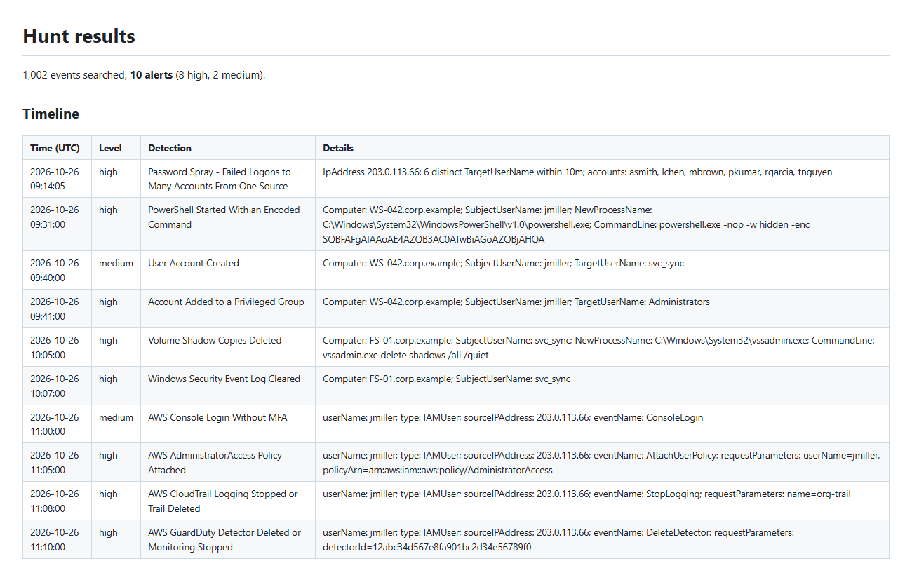

# soc-detections

[](https://github.com/Uppula4070/soc-detections/actions/workflows/ci.yml)

Detection-as-code for a SOC: **12 Sigma detection rules** for Windows Security logs and AWS CloudTrail. Every rule is:

- **tested in CI** against attack scenarios it must catch *and* look-alike activity it must ignore
- **converted automatically** to **Splunk SPL** and **Microsoft Sentinel KQL**
- **mapped to MITRE ATT&CK**, with a [coverage map](docs/coverage.md) that also shows the gaps

The repo also includes a **hunt mode** that runs every rule over log files and builds an incident timeline, and a **phishing email triage** tool that scores reported `.eml` files and drafts the ticket.

## Quick look

| | |
|---|---|
| [docs/rules.md](docs/rules.md) | Every rule with its description, ATT&CK mapping, false positives, and the generated SPL and KQL |
| [docs/coverage.md](docs/coverage.md) | ATT&CK coverage by tactic and technique, including the tactics not yet covered |
| [docs/sample-hunt.md](docs/sample-hunt.md) | Hunt results over a day of sample logs: a full intrusion reconstructed as a timeline |
| [docs/sample-phish-triage.md](docs/sample-phish-triage.md) | Triage of three reported emails: malicious, suspicious and benign |

## The hunt: one intrusion, ten detections, zero false positives

The sample logs ([`scripts/make_sample_logs.py`](scripts/make_sample_logs.py)) contain about 1,000 events of normal activity: logons, mistyped passwords, routine PowerShell scripts, a backup job listing shadow copies, and AWS API calls. Woven through them is one intrusion:

```
$ socdet hunt --logs windows=samples/windows-security.jsonl --logs aws=samples/cloudtrail.jsonl

1,002 events searched, 10 alerts (8 high, 2 medium).
09:14  high    Password Spray - Failed Logons to Many Accounts From One Source   IpAddress 203.0.113.66: 6 distinct TargetUserName within 10m
09:31  high    PowerShell Started With an Encoded Command                         WS-042, jmiller, powershell.exe -nop -w hidden -enc …
09:40  medium  User Account Created                                               svc_sync created by jmiller
09:41  high    Account Added to a Privileged Group                                Administrators
10:05  high    Volume Shadow Copies Deleted                                       FS-01, vssadmin.exe delete shadows /all /quiet
10:07  high    Windows Security Event Log Cleared                                 FS-01
11:00  medium  AWS Console Login Without MFA                                      jmiller from 203.0.113.66
11:05  high    AWS AdministratorAccess Policy Attached                            jmiller
11:08  high    AWS CloudTrail Logging Stopped or Trail Deleted                    org-trail
11:10  high    AWS GuardDuty Detector Deleted or Monitoring Stopped
```



Every step is caught, and none of the look-alike activity raises an alert. The brute-force rule stays quiet too: nine attempts against nine accounts is a *spray*, which is a different detection with a different response.

## A rule and its tests

```yaml
# rules/windows/win_password_spray.yml (Sigma)
title: Password Spray - Failed Logons to Many Accounts From One Source
logsource: {product: windows, service: security}
detection:
  selection:
    EventID: 4625
  timeframe: 10m
  condition: selection | count(TargetUserName) by IpAddress > 5
tags: [attack.credential_access, attack.t1110.003]
level: high
```

```yaml
# tests/cases/win_password_spray.yml
scenarios:
  - name: one IP tries 8 different accounts
    expect: 1
    events:
      - {EventID: 4625, IpAddress: 203.0.113.50, TargetUserName: "user{i}", _repeat: 8}
  - name: many failures for one account is brute force, not spray
    expect: 0
    events:
      - {EventID: 4625, IpAddress: 203.0.113.50, TargetUserName: alice, _repeat: 15}
```

Generated queries:

```spl
index=wineventlog source="WinEventLog:Security" EventCode="4625"
| bin _time span=10m
| stats dc(TargetUserName) as hits by _time, IpAddress
| where hits > 5
```

```kql
SecurityEvent
| where EventID == 4625
| summarize Hits = dcount(TargetUserName) by IpAddress, bin(TimeGenerated, 10m)
| where Hits > 5
```

`socdet test` fails CI if any rule misses an attack scenario, fires on a quiet one, has no test file, or can't be converted to both platforms.

## Rules

| Rule | Platform | ATT&CK |
|---|---|---|
| Brute force: many failed logons from one source | Windows | T1110.001 |
| Password spray: failed logons to many accounts | Windows | T1110.003 |
| PowerShell with an encoded command | Windows | T1059.001, T1027 |
| Volume shadow copies deleted (ransomware precursor) | Windows | T1490 |
| Security event log cleared | Windows | T1070.001 |
| Account added to a privileged group | Windows | T1098 |
| User account created | Windows | T1136.001 |
| Root account used | AWS | T1078.004 |
| Console login without MFA | AWS | T1078.004 |
| CloudTrail logging stopped or trail deleted | AWS | T1562.008 |
| AdministratorAccess policy attached | AWS | T1098.003 |
| GuardDuty detector deleted | AWS | T1562.001 |

## Phishing triage

```
$ socdet phish samples/emails/*.eml --protect samplelending.example
```

The tool works offline on the message itself and checks:
- **Authentication:** SPF, DKIM and DMARC results
- **Sender spoofing:** Reply-To and Return-Path mismatches, and a trusted display name sent from a foreign domain
- **Lookalike domains:** edit distance (`sarnplelending` vs `samplelending`) and brand-in-subdomain tricks
- **Links:** text that shows one domain but links to another, punycode, bare IPs, and URL shorteners
- **Attachments:** risky file types and double extensions (`Invoice.pdf.html`)
- **Wording:** urgency language and credential lures

Each finding adds a stated number of points. The ticket lists every reason, so an analyst can check the verdict rather than trust a black box. The sample lookalike invoice scores 100 (malicious), a "document shared, verify your account" email with a shortened link scores 30 (suspicious), and the internal newsletter scores 0.

## Engineering notes

- **The Sigma engine is small and tested.** It supports selections, `contains` / `startswith` / `endswith` / `all` modifiers, wildcards, `and` / `or` / `not` / `1 of` / `all of` conditions, and v1 aggregations (`count()` and distinct `count(field)` by group over a timeframe). One burst raises one alert, not one per event.
- **Field mapping is explicit.** `EventID` becomes `EventCode` for the Splunk Windows add-on, and CloudTrail fields map to Sentinel's `AWSCloudTrail` columns, with nested JSON read via `parse_json`. An unmapped AWS field is an **error**, not a silently broken query. That rule exists because reviewing the generated KQL during development showed `eventType` passing through unmapped (Sentinel calls it `EventTypeName`), and the query would have matched nothing. A test now guards it.
- **The ATT&CK map is accurate.** Techniques only appear under the tactics they belong to in ATT&CK, even when one rule has several tags.
- **38 unit tests** plus the rule scenarios, on Python 3.10–3.13, with ruff including Bandit security rules. CI regenerates the docs, sample logs and hunt report and fails if they drift.

## About the sample data

All logs and emails are **synthetic**. Hosts, users and account IDs are made up, IPs come from the documentation ranges (`203.0.113.0/24`, `198.51.100.0/24`), and domains use the reserved `.example` TLD. The encoded PowerShell string is a harmless placeholder. No employer data is used.
